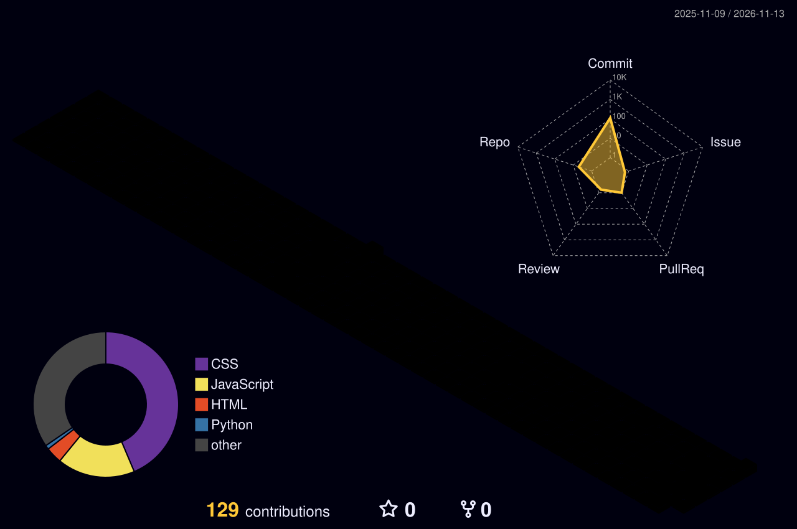

  

  

  

  

<h3 align="center">Estudante de Ciência da Computação</h3>

   <b>UFS</b> &nbsp;•&nbsp;  <b>Aracaju — SE, Brasil</b> &nbsp;•&nbsp;  <b>Desenvolvedor Full Stack</b>

  

  
  

  

  

  

<h4 align="center">Fern</h4>

  <i>Segundo cérebro em formato de aplicação desktop, para organizar notas e quadros.</i>

  
  

  

  

<h4 align="center">Arasaka</h4>

  <i>Projeto web desenvolvido com Python e Flask.</i>

  
  

  

  

  

  

  

  <picture>
    <source
      media="(prefers-color-scheme: dark)"
      srcset="https://raw.githubusercontent.com/BrunoZess/BrunoZess/output/github-contribution-grid-snake-dark.svg"
    />
    <source
      media="(prefers-color-scheme: light)"
      srcset="https://raw.githubusercontent.com/BrunoZess/BrunoZess/output/github-contribution-grid-snake.svg"
    />
    
  </picture>

 

  

